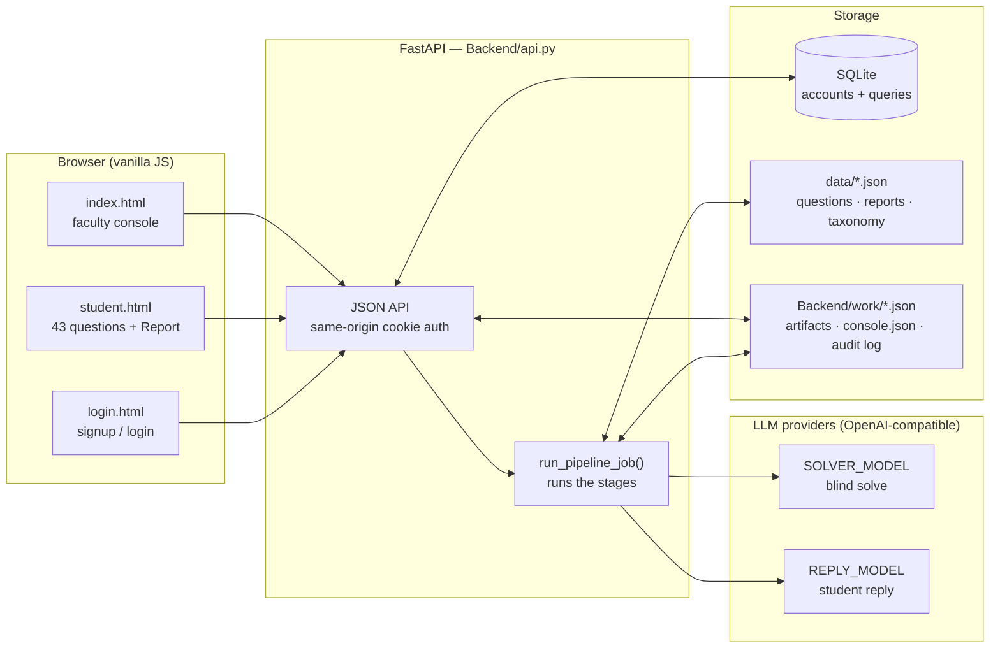
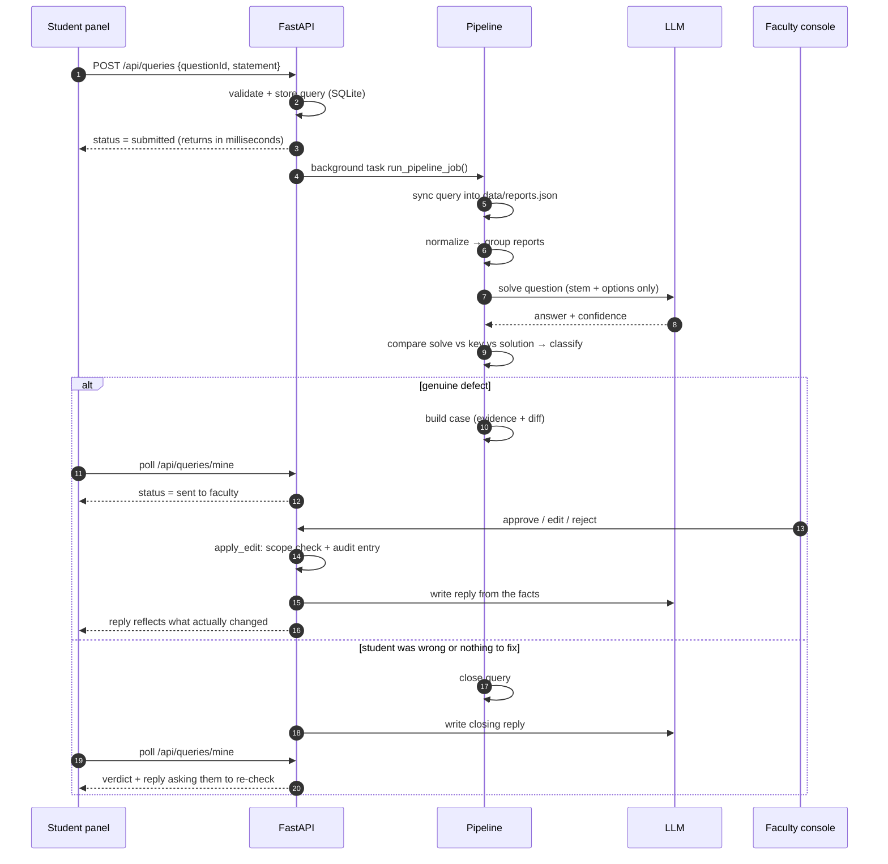
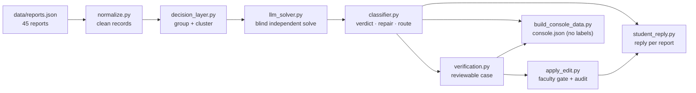

# Acadza "Report → Fix" loop

A student taps **Report question**. Instead of landing in a human queue, the report goes
through an AI triage pipeline that decides whether the question is really broken, proposes a
surgical fix, and — if it is broken — puts it in front of a faculty member with evidence.
Either way, the student gets a written reply.

## Live app

**https://acadza-report-resolve.vercel.app/**

| Role | Username | Password | Where |
|---|---|---|---|
| Student | `student` | `student123` | `/student.html` |
| Faculty | `faculty` | `faculty123` | `/` (console) |

`/login.html` also has signup for both roles, so you can create a throwaway account.

- The Vercel domain serves the frontend and rewrites `/api/*` to the backend
  (`Frontend/vercel.json`), so the login cookie stays same-origin.
- The backend sleeps when idle and wakes on the next request — the first page load may take a
  few seconds.
- The demo runs **with no LLM key** by serving precomputed results from
  `Backend/work/console.json`. Live solving and freshly written replies need the keys in
  `.env` (see *Running it* below).

---

## What it does, in plain terms

1. **Grouping.** 45 reports cover 43 distinct questions; duplicate complaints are clustered so
   the same question is judged once.
2. **Blind solve.** An LLM solves each reported question from the stem and options only. It
   never sees the answer key, the stored solution, or the student's comment — so when it
   disagrees with the key, that disagreement is real evidence rather than an echo.
3. **Classify.** The independent solve is compared against the key, the stored solution and
   the clustered complaint, and mapped to one verdict and repair type from
   `data/taxonomy.json`.
4. **Faculty gate.** Genuine defects become reviewable cases: rendered question, AI evidence,
   before/after diff, student reports. Nothing is applied to the live question without an
   approval, and every action is written to an audit log.
5. **Reply.** The student gets a message written for that specific report by a second, cheaper
   model — warm and specific if they were wrong, apologetic and factual if we were. It cannot
   claim a fix before the faculty applies one.

---

## Architecture



One service serves the API and the static pages, so there is no CORS layer and no
cross-origin cookie. The pipeline is plain Python writing JSON files; SQLite holds only demo
accounts and student queries, never pipeline state.

### Request lifecycle



The reply is written in both branches, from that report's real facts — never from a template. The
submit call only stores the query and queues the check (a local run returns in ~0.2 s); the
verdict and reply land on a later poll, once the pipeline has actually verified the report.

## Tech stack

| Layer | Choice | Why |
|---|---|---|
| Language | Python 3.11 (`.python-version`) | Pipeline and API share one language; no build step |
| API | FastAPI + uvicorn | Pydantic request models, static file serving, one process for API and pages |
| Dependencies | `fastapi`, `uvicorn` — that's it | Everything else is stdlib: `sqlite3`, `urllib`, `hmac`, `hashlib`, `json` |
| LLM calls | OpenAI-compatible chat completions over stdlib `urllib` | No SDK lock-in; any provider that speaks the format works, per-stage model and base URL |
| Database | SQLite (`data/demo.sqlite3`) | Demo accounts and student queries only; pipeline state stays in JSON files |
| Passwords | PBKDF2-HMAC-SHA256, 100k iterations, per-user salt | Stdlib, no third-party auth dependency |
| Sessions | HMAC-SHA256 signed cookie | Survives filesystem resets on a free host; no session table to lose |
| Frontend | Hand-written HTML/CSS/JS, no framework | The console renders production MathML/HTML as-is; a build step would only add risk |
| Tests | `pytest` for the API, Node + `jsdom` for frontend smoke tests | Node is needed for tests only, not to run the app |
| Backend hosting | Voroa web service (`uvicorn Backend.api:app`, health check `/api/health`) | Builds from GitHub; free tier sleeps when idle |
| Frontend hosting | Vercel, with `/api/*` rewritten to the backend | Same origin for pages and API, so the HttpOnly cookie is not treated as third-party |

## What it found in this data

| Result | Count |
|---|---|
| Reports processed | 45 (43 distinct questions) |
| Questions solved independently | 39 |
| Genuine defects | 26 |
| Routed `auto_apply` / `faculty_review` / `no_change` | 18 / 8 / 19 |

Against my hand-labelled key (`Backend/work/labels.json`), verdict, repair and route agree
**44/44**; the surgical `edit` is present for **29/44** reports. The 21 defects without a
structured edit are the ones a human should author — missing options, broken diagrams,
unanswerable items — and `results.json` reports that gap rather than inventing edits. Two
questions are honestly unanswerable as written and the solver refuses them instead of
inventing a missing number.

Bonus finding: the pipeline also flags defects nobody reported, which is what the independent
solve is for.

---

## The pipeline

Each stage is a standalone script with JSON in and JSON out, so any stage can be re-run or
inspected alone. `Backend/scripts/build_console_data.py` fuses the artifacts into the console
dataset offline (stdlib only) and leaves out the ground-truth labels.

| # | File | What it does | Output |
|---|---|---|---|
| 0 | `Backend/scripts/normalize.py` | Turns production HTML/MathML into clean records (prerequisite) | `work/questions.normalized.json` |
| 1 | `Backend/decision_layer.py` | Groups reports by question, clusters similar comments | `work/grouped_reports.json` |
| 2 | `Backend/llm_solver.py` | Solves each question independently — key, solution and comment are never in the prompt | `work/solved_answers.json` |
| 3 | `Backend/classifier.py` | Compares solve vs key vs solution vs complaint, assigns verdict, repair, route | `work/classification.json` |
| 4 | `Backend/Reply/verification.py` | Builds the reviewable case: evidence, plain-language error, before/after diff, severity | `work/verification_cases.json` |
| 5 | `Backend/Reply/apply_edit.py` | Faculty gate: re-validates the edit against repair scope, writes it, logs the audit entry, refuses a second apply | `work/live_questions.json`, `work/audit_log.jsonl` |
| 6 | `Backend/Reply/student_reply.py` | Model-written reply per report, in two sections: student's mistake and app's mistake | `work/student_replies.json` |



Routing is deterministic code, not a model opinion: the repair's `auto` flag from the taxonomy,
the fields it is allowed to touch, confidence ≥ 0.80, and a `find` string that is unique in the
field. A student's report alone never moves an answer key.

To see the isolation for yourself:

```bash
python Backend/llm_solver.py --dry-run     # prints one real prompt, calls nothing
```

### Two models, two keys

Stage 2 runs at `temperature: 0` with high reasoning effort on `SOLVER_*`; stage 6 runs at
`0.6` with low effort on `REPLY_*`. A shared `LLM_API_KEY` works as a fallback. Keeping them
apart means a big solve batch cannot eat the reply budget and a leaked reply key cannot spend
solver money.

Replies are never hardcoded. `student_reply.py` refuses to invent text without a key, and a
reply that fails the tone/content validator is regenerated, then skipped — not replaced with a
template.

---

## The two panels

**Student panel** (`/student.html`) — the same 43 production questions the console serves,
grouped by subject, with options and a **Report question** button. A report is appended to
`data/reports.json` and run through the real pipeline; no questions are invented.

**Faculty console** (`/`) — the triaged queue grouped by question and ordered by severity, with
the question rendered properly, a collapsible **answer key vs AI solve** card with the differing
tokens highlighted, the AI's verdict and evidence, the proposed diff, the student reports, and
approve / edit / reject that write to the audit log. **Process queries** runs the
pipeline on anything students raised.

**Auth** — demo accounts live in SQLite (`data/demo.sqlite3`, `Backend/demo_db.py`); pipeline
artifacts stay in JSON. Sessions are signed HMAC cookies rather than database rows, so a host
that resets its filesystem on deploy does not log everyone out mid-visit.

API: `/api/auth/{signup,login,logout,me}`, `/api/practice/questions`, `/api/queries`,
`/api/queries/mine`, `/api/console`, `/api/cases/{id}/{approve,reject}`, faculty-only
`/api/pipeline/run`, and `/api/health`. Console and case endpoints return 403 for a student
session.

---

## Running it

```bash
pip install -r requirements.txt
python run.py          # offline pipeline + build console data + serve http://127.0.0.1:8080
```

```bash
python run.py --solve         # also run pending independent solves (needs a key, resumable)
python run.py --replies       # also generate missing student replies (needs a key)
python run.py --full          # re-run both LLM stages from scratch
python run.py --serve-only    # serve API + files without running the pipeline
python run.py --port 9000     # different port
python run.py --host 0.0.0.0  # share on the local network
```

Copy `.env.example` to `.env` and add `SOLVER_API_KEY` / `REPLY_API_KEY` (or `LLM_API_KEY`) to
enable live solving and replies. Without a key the app still works end to end using the
precomputed dataset.

Tests:

```bash
python -m pytest tests/test_api.py -q      # API: auth, panels, query flow, faculty gate
npm install && npm run test:js             # frontend smoke tests (headless)
```

---

## What's in the repo

| Path | What it is |
|---|---|
| `Backend/` | Pipeline stages, the three Reply stages, FastAPI app, demo SQLite |
| `Frontend/` | Faculty console, student panel, login/signup |
| `data/` | 43 questions, 45 reports, taxonomy; `demo.sqlite3` is created at runtime |
| `Backend/work/` | Stage artifacts, audit log, `console.json`, hand-labelled `labels.json` |
| `results.json` | 45 entries, R001–R045, produced by `Backend/scripts/export_results.py` |
| `tests/` | API tests and frontend smoke tests |
| `PROMPTS.md` | Every in-product prompt verbatim, the prompts given to the coding agent, three times the AI was wrong, design decisions |
| `PRODUCT.md` | Who loses most when a question breaks, what is never auto-applied, week-1 metric, one idea beyond the brief |
| `DEPLOY.md` | Deployment notes (Voroa service + Vercel frontend with `/api` rewrite) |
| `Backend/README.md` | Stage-by-stage engineering detail |

`data/` and `Backend/work/labels.json` contain the given data and my hand-solved truth. The
labels are a yardstick for evaluation only — they are never an input to the pipeline, and
`build_console_data.py` excludes them from the console dataset.
